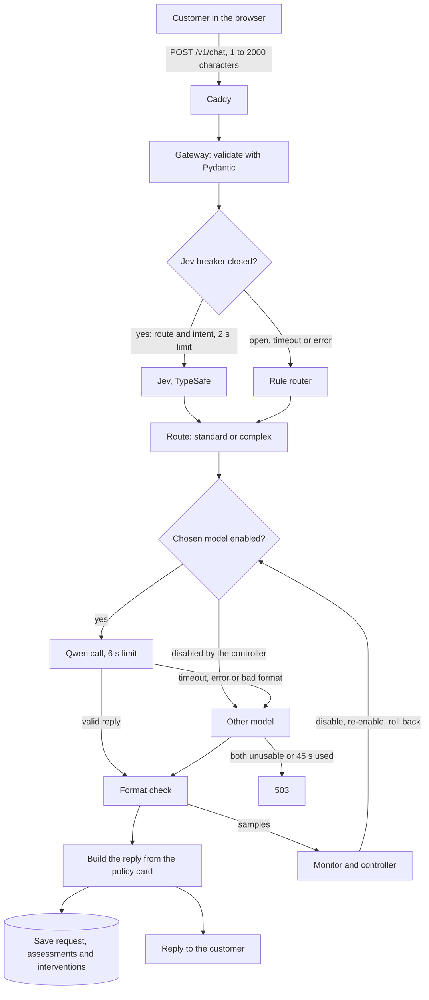
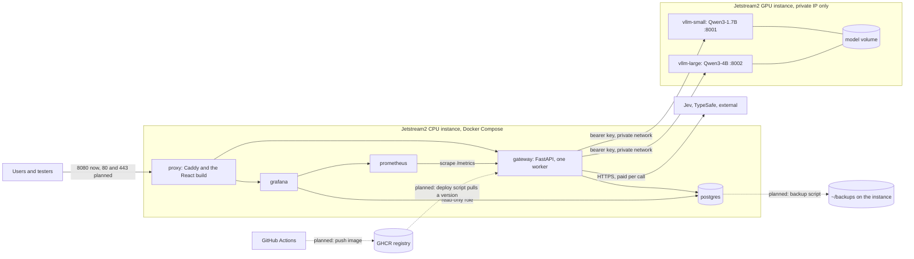
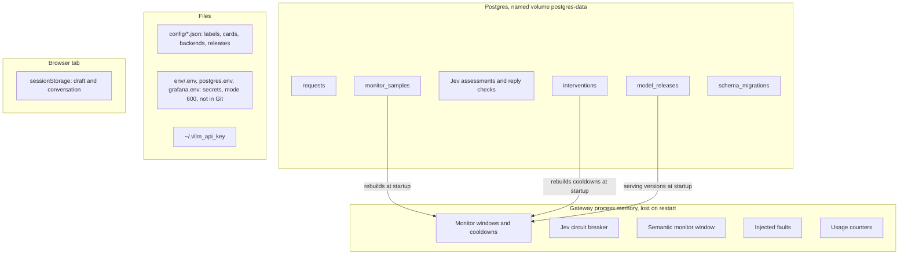

# Architecture

Four views of the system as built: **process** (what happens to one message), **execution** (what runs where and in what order), **state** (what is stored, and where) and **technical** (the parts and what talks to what). A fifth table lists where each **time limit** sits.

[`architecture.svg`](architecture.svg) is the status picture, generated from [`architecture.yaml`](architecture.yaml): it marks each part built, simulated or not built, and who owns it. The diagrams here are Mermaid, which GitHub draws in the page. Things drawn dashed are **not built yet** (the HTTPS proxy, the registry and the backup scripts); they are on the diagram because the deliverable asks where they sit.

## 1. Process: one chat message

The customer gets a reply built from an approved policy card; the model's own text is discarded. The save to Postgres has a 2 s limit and never blocks the reply for longer than that. The optional second Jev call (reply check) runs after the reply is built and never delays the customer.

## 2. Execution: what runs where

Start order on the CPU instance: `postgres` healthy, then `gateway` healthy, then `proxy`; `grafana-db-setup` runs once. Both instances start their stacks at boot with systemd units (`smart-gateway-cpu.service`, `smart-gateway-gpu.service`); the GPU unit starts `vllm-small` before `vllm-large`. Only `proxy` publishes a port; the vLLM servers bind to the GPU instance's private IP.

## 3. State: where each piece lives

The customer's message is stored nowhere on the server. After a restart the gateway rebuilds the monitor windows and cooldowns from `monitor_samples` and `interventions`, and the serving versions from `model_releases`. It does not rebuild the breaker, the faults or the counters. Prometheus data and Grafana state are named volumes that are not backed up.

## 4. Technical: the parts

| Layer | Part | Notes |
| --- | --- | --- |
| Frontend | React (Vite) build, served by Caddy | Chat, Health, Jev and Metrics (embedded Grafana). Hashed files under `/assets` are cached for a year; `index.html` is `no-cache` |
| Proxy | Caddy 2.11.7 | Routes `/` to the React app, `/v1`, `/docs`, `/redoc`, `/openapi.json` to the gateway, `/grafana` to Grafana. `/metrics` is never proxied. **HTTPS on 80 and 443 is planned**; today it is plain HTTP on 8080 |
| Gateway | FastAPI, one uvicorn worker, Pydantic Settings | Routes, `Gateway` flow, router, backends, monitor, controller. The model, router and store are chosen by settings |
| Router | `TypeSafeJevRouter` (real) or `MockJevRouter`, with `RuleRouter` as the fallback and a circuit breaker | |
| Models | `VLLMBackend` (real) or `MockBackend`, over the OpenAI-style API | Qwen3-1.7B (small) and Qwen3-4B (large) on the GPU instance |
| Store | `PostgresStore` (psycopg 3) or `MemoryStore`; numbered SQL migrations at startup | |
| Monitoring | Prometheus, Grafana (anonymous viewer), 8 alert rules tested with promtool | Targets and queries are in `config/metrics.yaml` |
| CI | GitHub Actions: ruff, mypy, pytest with Postgres, frontend tests, Compose smoke, diagram and docs checks | **Planned:** build and push an image to GHCR named from the commit, and smoke-test it |
| Deploy | `docker compose up -d --build --wait` by hand; systemd units start the stacks at boot | **Planned:** a deploy script that pulls a version, records the digest, and rolls back with an older version |
| Backup | `pg_dump -Fc` by hand into `~/backups` | **Planned:** backup and restore scripts. No restore has been tested yet |

## 5. Time limits

| Limit | Value | Setting | What happens when it runs out |
| --- | --- | --- | --- |
| Whole chat request | 45 s | `APP_REQUEST_DEADLINE_SECONDS` | The request ends with 503 `deadline_exceeded` if the other model was also cut short |
| Jev call (route and intent) | 2 s | `APP_JEV_TIMEOUT_SECONDS` | The rule router answers instead; the breaker counts a failure |
| Jev breaker | 5 failures, then 30 s open | `APP_JEV_BREAKER_FAILURES`, `APP_JEV_BREAKER_COOLDOWN_SECONDS` | Jev is skipped and the rule router is used until the cooldown ends |
| Reserve for the other model | 15 s | `APP_ALTERNATE_RESERVE_SECONDS` | The first attempt gets the time left minus this, so the other model can still answer |
| One model call, while the other could answer | 6 s | `APP_ATTEMPT_TIMEOUT_SECONDS` | The call is cut off, counts as a failed call, and the other model answers |
| Timeouts in a row that disable a model | 3 | `APP_MONITOR_TIMEOUT_STREAK` | The controller disables the model without waiting for 5 samples |
| Controller cooldown | 60 s | `APP_CONTROLLER_COOLDOWN_SECONDS` | The model is re-enabled with an empty window |
| Store write | 2 s | `APP_STORE_TIMEOUT_SECONDS` | The reply goes out without being saved; the log has a warning |
| Reply check (optional) | 10 s | `APP_JEV_REPLY_CHECK_TIMEOUT_SECONDS` | The check is dropped. It never delays the customer |
| Container health checks | gateway: every 10 s, 5 s limit, 5 tries | `Dockerfile`, `compose.yml` | The container is marked unhealthy; Compose will not start dependents |
| Grafana database queries | read-only role, statement timeout 5 s | `grafana/` provisioning | A long query is cancelled |
| Boot unit | 5 min per try on the CPU instance, 3 tries | `deploy/autostart/` | The unit stops; `reset-failed` clears it |

The values are the defaults on `main`. The 6 s limit is from one evaluation run's latencies (medians 0.37 s and 0.85 s), not from tester load.
